# box-creature-animation · 方块小生物治愈系短视频

一个 Agent Skill，用来做「方块小生物」风格的 2D 扁平手绘治愈系短视频。歌词 MV、故事绘本、剧情短片、旁白科普都能做。默认用 [Remotion](https://www.remotion.dev/) 写代码生成视频，需要时也可以输出 AI 生图/生视频提示词。

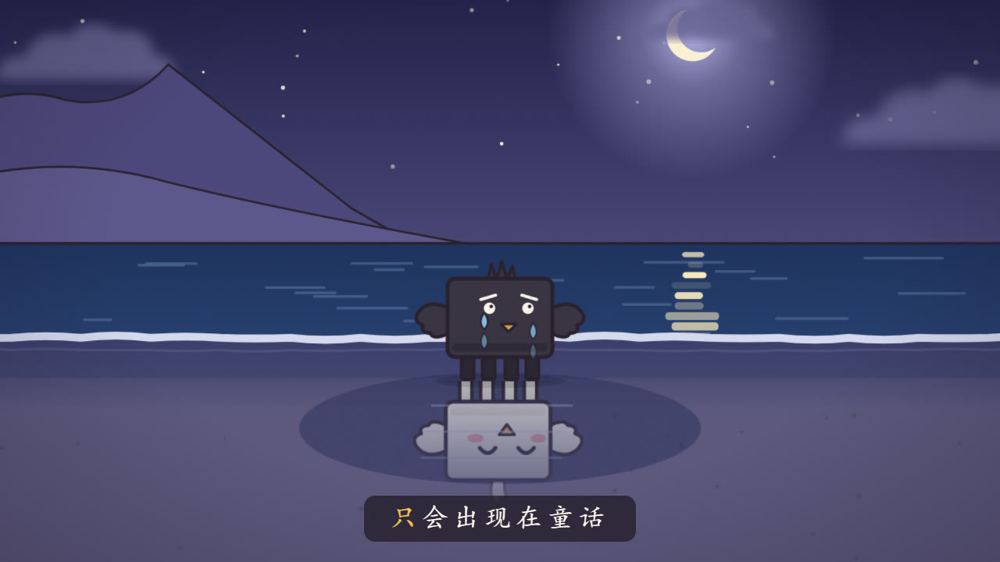

## 风格

- **角色**：极简方块造型的小生物，圆角矩形身体、短腿、点状眼，配漫画式情绪符号（? ! 汗 爱心 Zzz 等）
- **画面**：2D 扁平手绘、深色描边、纸面颗粒、柔光；低饱和，治愈里带一点情绪
- **场景**：内容决定场景，没有默认场景。城市雨夜、温暖房间、森林、雪地、海边、海底、星空都行，积木里没有的地方也按同一套画风现画

## 安装

这是标准的 Agent Skill 结构（入口 `SKILL.md`，frontmatter 含 `name` / `description`）。把整个文件夹放进所用智能体的技能目录即可。

启用后，在对话里提到「方块小人动画」「治愈系小动画」「歌词 MV」之类的需求就会触发它；支持斜杠命令的环境也可以直接输入 `/box-creature-animation`。

## 目录结构

```
box-creature-animation/
├── SKILL.md          # 技能入口：工作流程与方案选择
├── style.md          # 画风圣经：角色造型、配色、线条、表情符号、镜头语言
├── scenes.md         # 场景积木用法、常见场景配方、新场景设计规则
├── storyboard.md     # 歌曲 / 故事 / 剧情的拆镜规则与分镜表模板
├── subtitles.md      # 歌词、旁白、对白字幕的自动生成方案
├── prompts.md        # AI 生图/生视频提示词（备选方案）
├── templates/
│   └── remotion/     # Remotion 组件模板（详见其中的 README.md）
├── scripts/
│   ├── tts.py        # edge-tts 旁白/对白配音 + 句级字幕时间戳
│   ├── lrc.cjs       # LRC 或纯文本歌词 → 字幕 cues
│   └── ambient.cjs   # 合成氛围配乐（钢琴琶音 + 海浪/雨/风）
└── refs/             # 模板渲染出的参考图
```

## 预设场景

`templates/remotion/Presets.tsx` 里有 11 个预设场景（`PRESETS`），参考图在 `refs/`：

| 预设 | 参考图 | 预设 | 参考图 |
|---|---|---|---|
| `seasideDusk` 海边黄昏 | 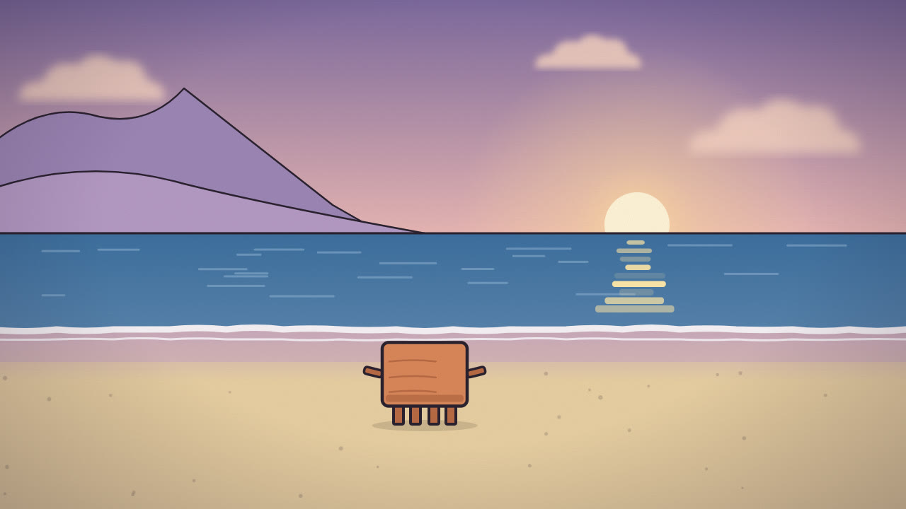 | `warmRoom` 温暖房间 | 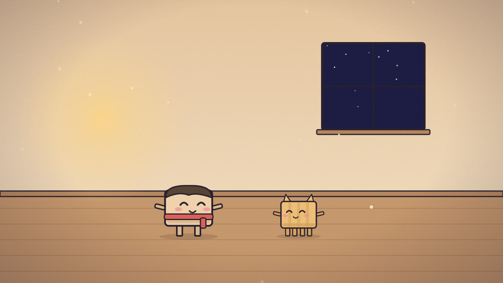 |
| `seasideDay` 海边白天 | 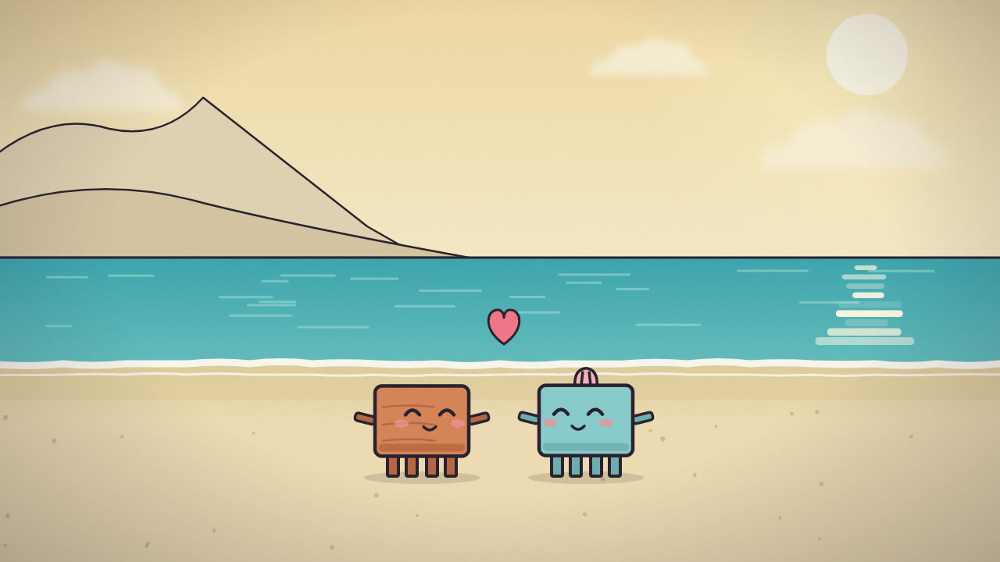 | `forest` 森林 | 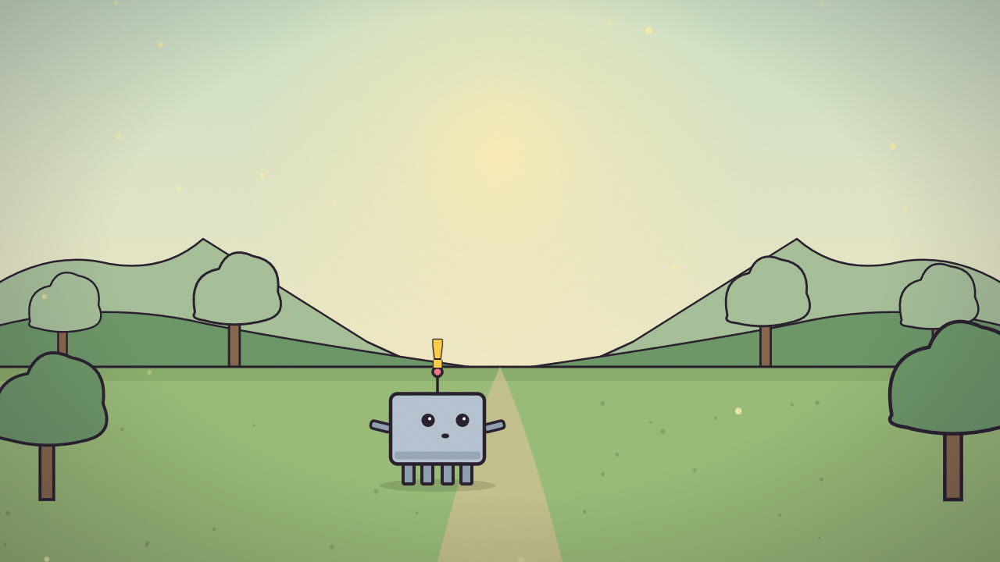 |
| `seasideNight` 海边夜晚 | 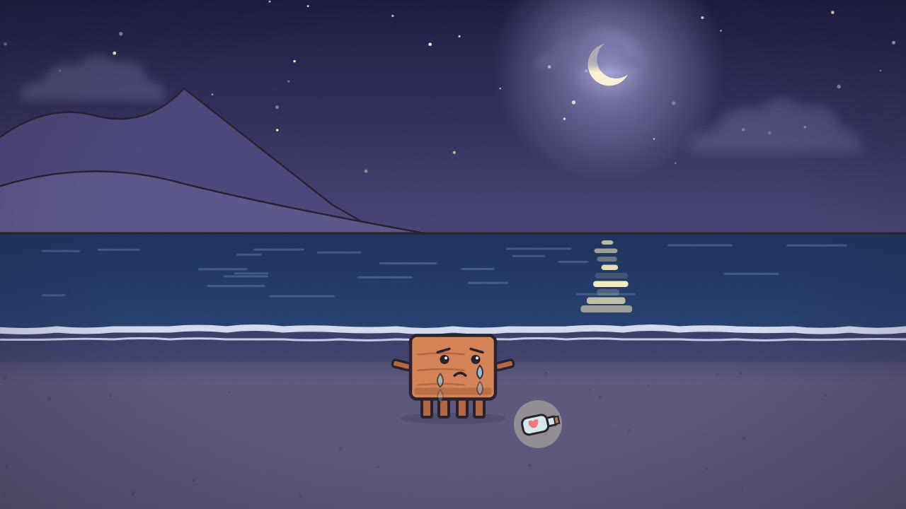 | `snow` 雪地 | 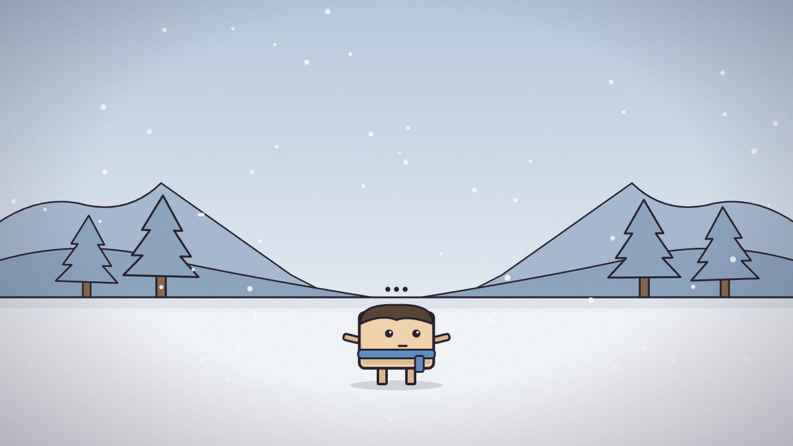 |
| `dawn` 清晨 | 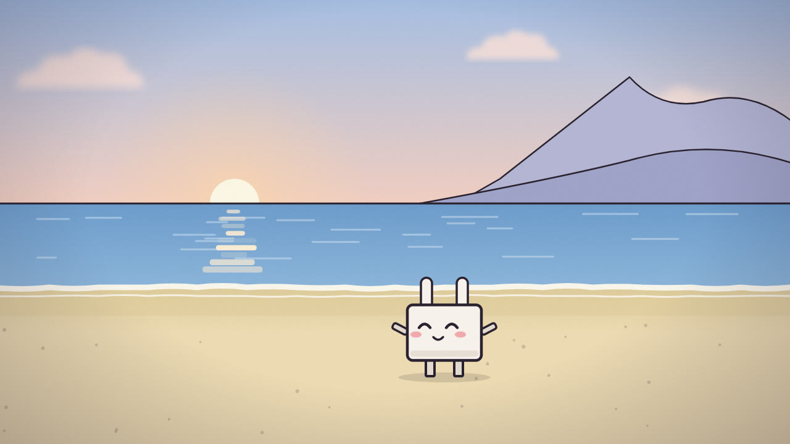 | `parkBench` 公园长椅 | 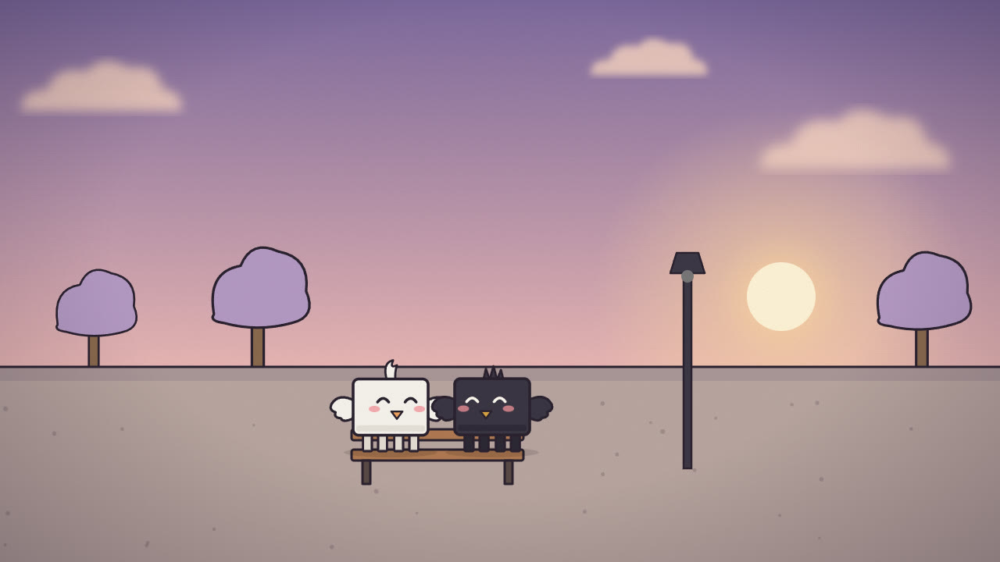 |
| `rainyCity` 城市雨夜 | 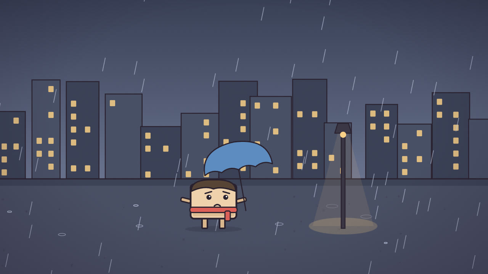 | `starryHill` 山坡星空 | 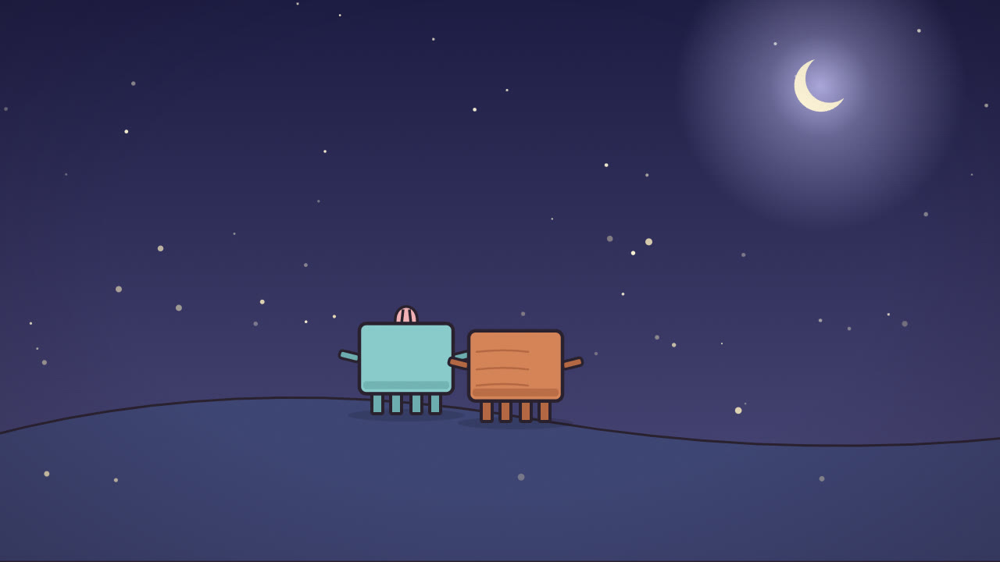 |
| `underwater` 海底 | 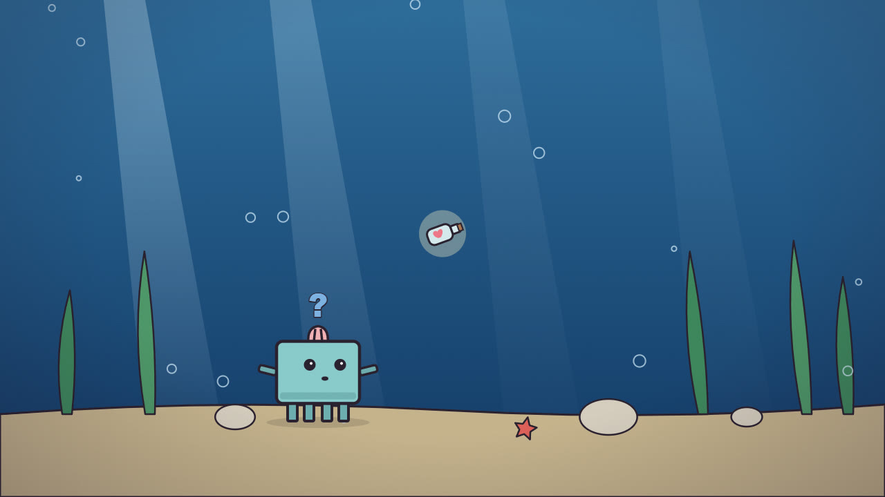 | | |

预设不合适时，用 `Scenery.tsx` 的积木重新组合（比如「雪夜城市」= `City` + `Snow` + `NIGHT` 色板），积木也没有的就用 SVG 现画。

## 工作流程（Remotion 方案）

1. 识别内容类型：歌曲 / 故事 / 剧情对白 / 旁白科普
2. 设计角色：人物、动物、拟物都做成方块小生物
3. 设计场景：按地点、时间、天气、情绪选预设、组合积木或现画
4. 拆分镜：输出分镜表（时间 / 字幕 / 场景 / 动作 / 表情符号 / 运镜 / 转场）
5. 准备音频与字幕时间轴：全部由脚本自动生成，不手写帧号
6. 搭工程：把 `templates/remotion/` 复制到项目 `src/<片名>/`，写主合成并在 `Root.tsx` 注册
7. 自查：`npx tsc --noEmit`，用 `npx remotion still` 渲染关键帧逐张检查
8. 渲染：`npx remotion render <id> out/<片名>.mp4`，再用 ffprobe 核对时长和音轨

完整细节见 [SKILL.md](SKILL.md)。

## 脚本速查

```bash
# 旁白/对白配音 + 字幕时间戳（需联网，pip install edge-tts）
python scripts/tts.py story.json src/<片名>/voice.ts public/<片名>/voice [--rate=-6%] [--public-prefix=<片名>/voice]

# LRC 歌词截取片段 → 字幕
node scripts/lrc.cjs song.lrc src/<片名>/cues.ts --from 00:55.28 --to 01:02.10 [--offset 0.3] [--lead 0.5]

# 纯文本歌词按字数估时 → 字幕
node scripts/lrc.cjs lyrics.txt src/<片名>/cues.ts [--cps 3] [--gap 0.3]

# 合成氛围配乐
node scripts/ambient.cjs public/<片名>/bgm.wav --dur 10 --chords "F:0,C:3.07,G:4.67,Am:6.27" [--waves] [--rain] [--wind]
```

不带参数运行脚本会打印用法说明。

## 环境要求

- Node.js（Remotion 及 `lrc.cjs`、`ambient.cjs`）
- Python 3 + `edge-tts`（只在需要配音时用）。遇到 `403 Invalid response status` 时先 `pip install -U edge-tts`
- 中文字幕默认用楷体，放到项目 `public/fonts/simkai.ttf`；Windows 可以从 `C:/Windows/Fonts/simkai.ttf` 复制

## 注意

- 不要把受版权保护的原曲放进成片，除非用户自己提供了音频；没有音频时用 `ambient.cjs` 合成氛围音
- Remotion 自带的 ffmpeg 是精简版，抽帧请用 `-ss <秒> -frames:v 1`
- 字幕占底部约 90px，关键内容不要放进去；角色体型约占画面高度的 1/5 到 1/4
